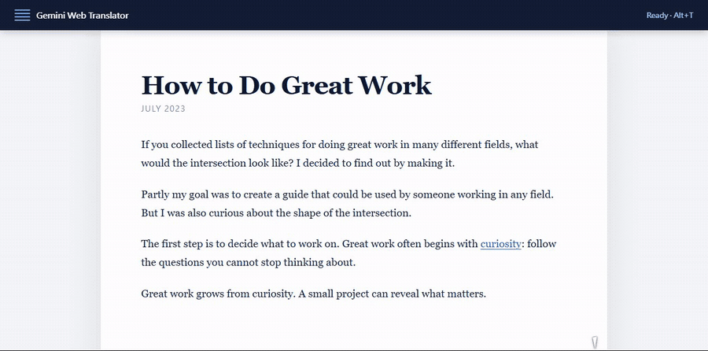

<p align="center">
  
</p>

<h1 align="center">Gemini Web Translator</h1>

<p align="center">
  <b>保留原文，在每個段落下方加上自然的臺灣繁體中文翻譯</b>
</p>

Gemini Web Translator 是一個 Chrome 擴充功能。它會找出網頁中的標題、段落和列表，將內容分批交給 Gemini，再把譯文放回原文下方。原始內容不會被覆蓋，再次切換即可還原頁面。

翻譯只會在段落接近畫面時進行。它使用你自己的 Gemini API key，沒有中間伺服器，也不需要註冊其他服務。

<p align="center">
  
</p>

## Features

- 保留原文，將臺灣用語的繁體中文譯文放在段落下方。
- 將滑鼠移到譯文短句上，以淡藍灰底色標出對應原文；點擊即可固定對照。
- 保留原文中的超連結，翻譯後的連結文字仍可直接點擊。
- 只翻譯接近畫面的內容，避免一次送出整篇長文章。
- 預取後方一整批內容並快取譯文，減少捲動、重新整理與重複閱讀造成的 API 請求。
- 支援專有名詞保留與固定譯法，翻譯規則可直接在選項頁設定。
- 使用自己的 Gemini API key，網頁內容不會經過額外的中間伺服器。

## Install

```sh
git clone https://github.com/yPin9/gemini-web-translator.git
cd gemini-web-translator
```

不使用 Git 的話，可以在 GitHub 選擇 **Code → Download ZIP**，下載後解壓縮。

接著在 Chrome 中：

1. 開啟 `chrome://extensions`。
2. 開啟「開發人員模式」。
3. 點選「載入未封裝項目」。
4. 選擇專案資料夾。

安裝或重新載入擴充功能後，原本已經開啟的分頁需要重新整理一次。

## API key

每位使用者都需要設定自己的 Gemini API key：

1. 前往 [Google AI Studio API Keys](https://aistudio.google.com/apikey)。
2. 登入 Google 帳號，建立並複製 API key。
3. 點擊 Chrome 工具列上的 Gemini Web Translator icon。
4. 選擇「開啟選項設定」。
5. 將 key 貼到「Gemini API Key」欄位。
6. 按「儲存」，再按「測試連線」。

也可以從 `chrome://extensions` 找到 Gemini Web Translator，進入「詳細資料」後選擇「擴充功能選項」。

API key 會儲存在目前瀏覽器的 `chrome.storage.local`。它不會跟著專案或 Git 上傳，所以每台電腦、每個 Chrome 使用者設定檔都需要分別設定。

## Quick start

1. 先完成 API key 設定並確認測試連線成功。
2. 如果有專有名詞或固定譯法，在同一頁的「術語表」欄位加入規則並儲存。
3. 打開要閱讀的網頁，按 **Alt+T**，或從工具列選擇「翻譯此頁」。
4. 將滑鼠移到譯文短句上，對應的原文會同步高亮；點一下可固定高亮，按 **Esc** 或點擊空白處即可取消。
5. 再按一次 **Alt+T**，或選擇「還原原文」，即可移除譯文。

Chrome 內建頁面、Chrome Web Store 和其他瀏覽器保護頁面不允許擴充功能注入內容，因此無法翻譯。

## How it works

啟動翻譯時，content script 會掃描目前頁面，略過不可見、可編輯、程式碼、純符號及中文比例很高的內容。符合條件的段落會交給 `IntersectionObserver`，只有接近畫面的內容才會進入翻譯佇列。

段落會依句子切成可配對的短句，但仍以批次送出；每個批次最多包含 60 個短句或 6,000 個字元。service worker 會套用術語保護與臺灣繁中翻譯指令，呼叫 Gemini API，然後驗證回傳的 JSON、資料型別及譯文數量。驗證通過後，content script 才會把譯文插入原文下方。請求之間會自動節流，遇到 429 時則延長退避時間。滑鼠高亮只在瀏覽器內處理，不會產生額外的 API 請求。

請求支援 30 秒逾時、`Retry-After`、指數退避和有限次數重試。如果使用者在請求期間還原或重新啟動翻譯，舊回應會失效，不會再修改頁面。

## API limits

Gemini 會依專案、模型與使用層級限制每分鐘請求數、每分鐘 Token 和每日請求數。同一個 Google Cloud 專案建立的多把 API key 會共用額度，實際上限請查看 [Google AI Studio Rate Limits](https://aistudio.google.com/rate-limit)。

擴充功能會合併畫面後方的短句、控制請求間隔，並將成功譯文保存在本機。相同的原文、模型、目標語言與術語表設定會直接使用快取，不再呼叫 API。如果每日額度已經用完，仍需等待 Google 重置額度或調整專案的使用層級。

## Terms

術語表可以保留專有名詞，或替詞彙指定固定譯法。

設定位置：

1. 點擊 Chrome 工具列上的 Gemini Web Translator icon。
2. 選擇「開啟選項設定」。
3. 在「術語表」欄位中，每行填寫一筆規則。
4. 按「儲存」後，新的翻譯工作就會使用這份規則表。

也可以從 `chrome://extensions` 找到 Gemini Web Translator，進入「詳細資料」後選擇「擴充功能選項」。

規則分成兩種：

| 想要的行為 | 寫法 | 結果 |
|---|---|---|
| 這個詞不要翻譯 | `process` | 原文是 `Process`，譯文仍保留 `Process` |
| 這個詞一定要這樣翻 | `software = 軟體` | 每次命中 `software` 都使用「軟體」 |

完整範例：

```text
# 保留原文
process
program
C++
OpenAI

# 指定固定譯法
software = 軟體
database = 資料庫
memory = 記憶體
```

只填一個詞時，譯文會保留網頁中的原詞和大小寫。使用 `來源詞 = 目標詞` 時，擴充功能會套用指定譯法。

- 英文字母比對不區分大小寫。
- 只比對完整詞彙；`process` 不會命中 `processing`。
- 較長的詞彙優先。
- 空白行和以 `#` 開頭的行會略過。
- 重複詞彙以第一筆為準。
- 最多讀取 100 筆，每個來源詞最長 100 個字元。

送出翻譯前，命中的術語會被換成保護標記。Gemini 回傳後，擴充功能才會還原原詞或套用固定譯法。如果標記遺失、遭到修改或重複，該批結果會被拒絕。

目前術語表不是專案資料夾裡的獨立規則檔，不需要修改 `background.js` 或其他程式碼。按下「儲存」後，內容會寫入目前瀏覽器的 `chrome.storage.local`；不同電腦或不同 Chrome 使用者設定檔需要各自設定一次。

## Configuration

| 設定 | 說明 |
|---|---|
| Gemini API Key | 儲存在本機，呼叫 Gemini 時用於驗證 |
| 模型 | 預設為 `gemini-flash-lite-latest` |
| 目標語言 | 預設為 `繁體中文` |
| 術語表 | 保留原詞或指定固定譯法 |
| 翻譯快取 | 儲存在本機，可從選項頁手動清除 |

當目標語言包含繁體中文、正體中文、Traditional Chinese 或 `zh-TW` 時，擴充功能會要求 Gemini 使用臺灣常見詞彙和語序，並避免簡體字及中國大陸慣用詞。

免費層可用模型與額度可能調整，實際狀態以 Google AI Studio 顯示的內容為準。本擴充功能不會替使用者開啟付費功能，是否計費取決於 API key 所屬 Google Cloud 專案。

## Privacy

這個專案沒有自建後端。API key、模型、目標語言、術語表和已完成的翻譯快取都儲存在瀏覽器的 `chrome.storage.local`。快取最多保留約 1,200 個短句或 200 萬字元，可從選項頁隨時清除。

只有在使用者啟動翻譯後，畫面附近需要翻譯的網頁文字才會直接傳送到 Google Gemini API。API key 透過 `x-goog-api-key` header 傳送，不會放在 URL。

不要把 API key 寫進程式碼、commit 到 GitHub，或交給其他人共用。也不要在含有密碼、個人資料、公司機密或其他敏感資訊的頁面啟動翻譯。

## Development

這是一個沒有建置步驟的 Chrome Manifest V3 擴充功能。測試使用 Node.js 內建工具，建議使用 Node.js 18 以上版本。

```sh
npm run check
npm test
```

`npm run check` 會檢查 JavaScript 語法。`npm test` 會測試 API key 傳送方式、暫時性錯誤重試、譯文數量驗證、術語保護、本機快取、舊式網頁排版，以及還原頁面後忽略舊 API 回應。

主要檔案：

| 檔案 | 用途 |
|---|---|
| `background.js` | Gemini API、術語保護、回應驗證與重試 |
| `content.js` | 掃描段落、安排翻譯、插入譯文與還原頁面 |
| `popup.html` / `popup.js` | 工具列選單 |
| `options.html` / `options.js` | API key、模型、目標語言、術語表與快取管理 |
| `test/` | 回歸測試 |

## Status

目前可以翻譯一般靜態網頁，以及捲動後才進入畫面的既有段落。

- SPA 在啟動翻譯後動態新增的內容不一定會被偵測。
- 術語表尚未支援匯入、匯出或跨裝置同步。
- 專案尚未發佈到 Chrome Web Store，需要自行載入專案資料夾。
- 翻譯品質、可用模型與額度取決於 Gemini API。
